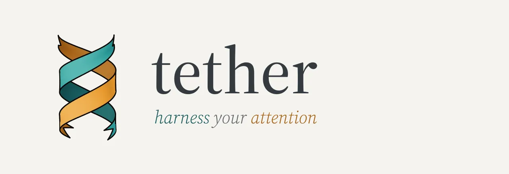
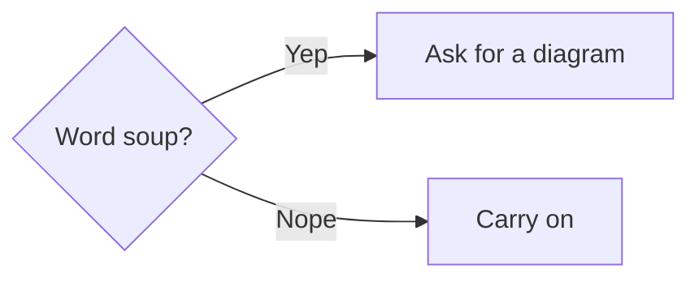
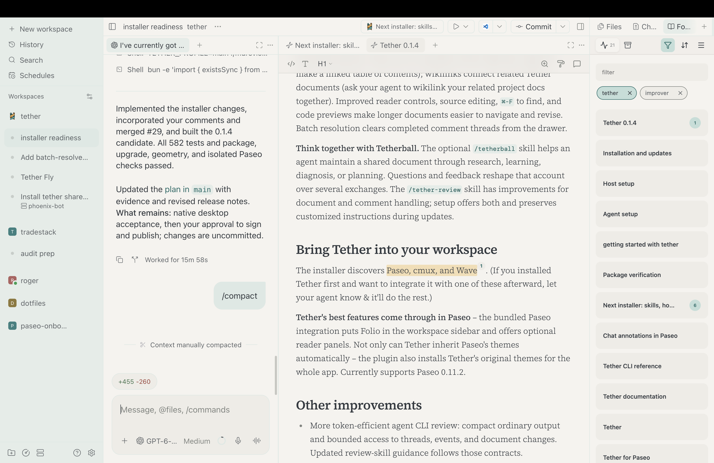
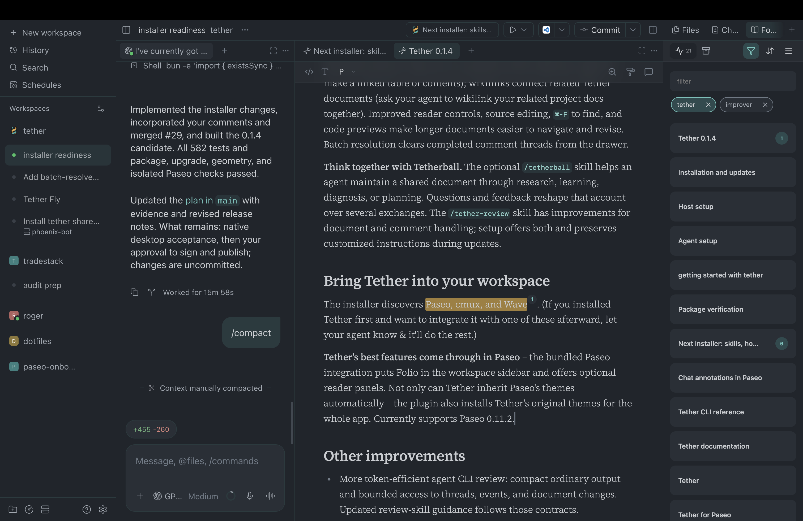

# Tether 0.1.4

## Keep your attention on the work

**Comment directly on agent chats in Paseo.** Select text in the chat window, add your comments, and send them all in a batch on your next turn. Annotations persist, and submitted quotes remain readable. This integration adapts [Annotations by neunzig-zehn](https://github.com/neunzig-zehn/paseo-annotations), including work inherited from Quote by Chechulin Serhii; their MIT notices are included in the plugin.

**Too wordy? Ask your agent for a diagram.** Tether renders Mermaid diagrams locally, giving agents another way to explain a system, compare decision paths, or make documentation easier to follow. Expand a diagram, zoom and pan through it, then return to the document. Diagrams follow Tether’s selected theme.

**Move through connected documents.** Links to headings and in-document anchors take you to a specific section (ask your agent to make a ***linked table of contents***); wikilinks connect related Tether documents (ask your agent to ***wikilink your related project docs*** ***together***). Improved reader controls, source editing, `⌘-F` to find, and code previews make longer documents easier to navigate and revise. Batch resolution clears completed comment threads from the drawer.

**Think together with Tetherball.** The optional `/tetherball` skill helps an agent maintain a shared document through research, learning, diagnosis, or planning. Questions and feedback reshape that account over several exchanges. The `/tether-review` skill has improvements for document and comment handling; setup offers both and preserves customized instructions during updates.

## Bring Tether into your workspace

The installer discovers [Paseo](https://paseo.sh/), [cmux](https://cmux.com/), and [Wave](https://www.waveterm.dev/). (If you installed Tether first and want to integrate it with one of these afterward, let your agent know & it'll do the rest.)

**Tether's best features come through in Paseo** – the bundled Paseo integration puts Folio in the workspace sidebar and opens documents in custom Tether panels by default on desktop. You can turn off **Open documents in custom Tether panels** in Settings → Tether to use browser tabs if a Paseo update breaks panels. Not only can Tether inherit Paseo's themes automatically – the plugin also installs Tether's original themes for the whole app. Currently supports Paseo 0.11.2.

*Tether Light in Paseo.*

*Tether Dark in Paseo.*

## Other improvements

* Leaner agent CLI review: measured review workflows returned **52% less output**.
* Expanded Markdown support, including footnotes and math.
* Visual polish across the reader and Folio.
