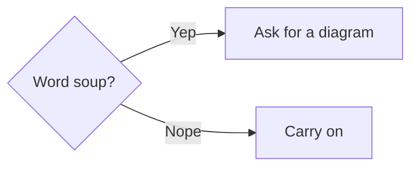

# Tether 0.1.5 Release Notes

## New features to help you focus

**Comment directly on agent chats in Paseo.** Select text in the chat window, add comments, and send them all in a batch on your next turn. Annotations persist, and submitted quotes remain readable. This integration adapts [Annotations by neunzig-zehn](https://github.com/neunzig-zehn/paseo-annotations), including work inherited from Quote by Chechulin Serhii (see [MIT notices](https://github.com/hartphoenix/tether/blob/main/integrations/paseo/chat/NOTICE.md)).

**Too wordy? Ask your agent for a diagram.** Tether renders Mermaid diagrams, giving agents another way to explain a system, compare decision paths, or make stuff easier to follow. Pinch/zoom a diagram or image to expand it; press `esc` to close. Diagrams follow Tether’s selected theme.

**Comment on specific parts of images and diagrams.** Hover your cursor over the image/diagram, choose **Comment**, then drag a rectangle around the part you want to describe (try it on the diagram above). Tether saves your comment with a capture of that region, so your agent can look at what you selected. Click a highlighted region to open its thread.

**Browse through connected documents.** Ask your agent for a ***linked table of contents*** or links between sections. To connect separate docs, ask it to ***wikilink your related project docs together*** ([[../getting-started.md|like so]]).

**Think together with /tetherball.** The `/tetherball` skill helps your agent maintain a shared document through long processes like research, learning, diagnosis, or planning. Your questions and feedback sculpt the doc, so it grows more precise without growing longer. Style guidance adapted from [Mariven](https://gist.github.com/Mariven/17c2223a1293559a0b6868fbb136fedd).

**Smoother overall.** Improved controls, markdown-source editing, and `⌘-F` to find make it easy to navigate and revise long docs. Batch selection lets you resolve multiple threads from the drawer or archive multiple docs from the folio.

## Add Tether to your workspace

The installer discovers [Paseo](https://paseo.sh/), [cmux](https://cmux.com/), and [Wave](https://www.waveterm.dev/). If you add one of these after installing Tether, ask your agent to integrate it.

**Tether's best features come through in Paseo.** The bundled Paseo integration adds Folio to the sidebar, inline chat annotations, and shared themes: Tether can follow Paseo's theme, and the plugin adds Tether's original themes to the whole app. It requires Paseo 0.11.2 or later. To configure it, open Paseo **Settings → Plugins → Tether → ⋯ → Settings**. [[../guide/paseo.md|Tether in Paseo]] covers setup and settings in detail.

*Tether Light in Paseo.*

*Tether Dark in Paseo.*

## Other improvements

* Leaner agent CLI review: measured review workflows returned **52% less output**.
* Expanded Markdown support, including footnotes and math.
* Visual polish across the reader and Folio.

