# Diagram renderer comparison

The same Mermaid source renders in both readers. The only difference between the two files is the `diagrams: mermaid` frontmatter in the Mermaid file.

## Review loop

A flowchart with subgraphs, labeled edges and a feedback cycle.

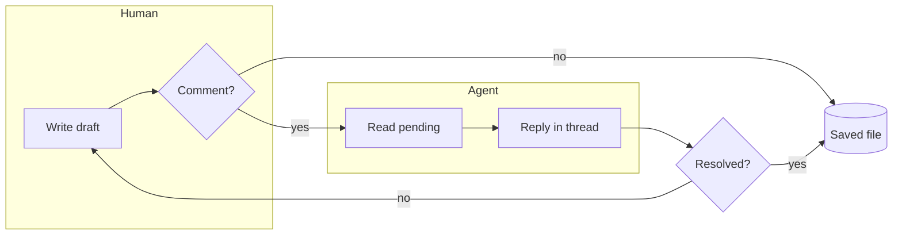

## Comment round trip

A sequence diagram with activations, a note and an alternative.

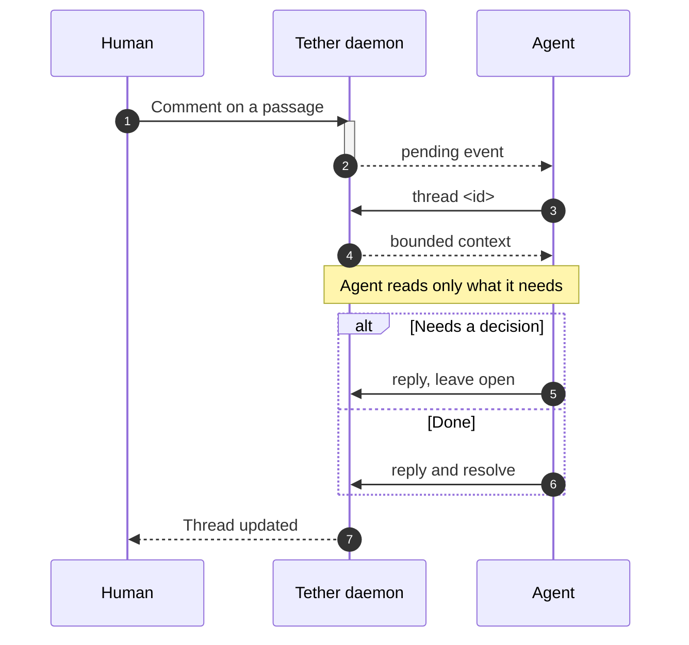

## Thread lifecycle

A state diagram with a composite state.

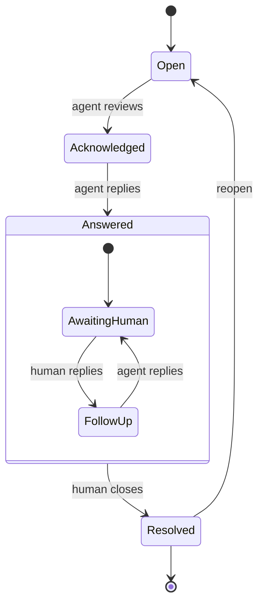

## Visual anchor model

A class diagram.

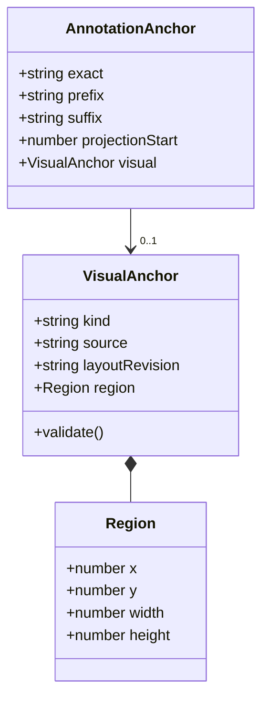

## Private review storage

An entity-relationship diagram.

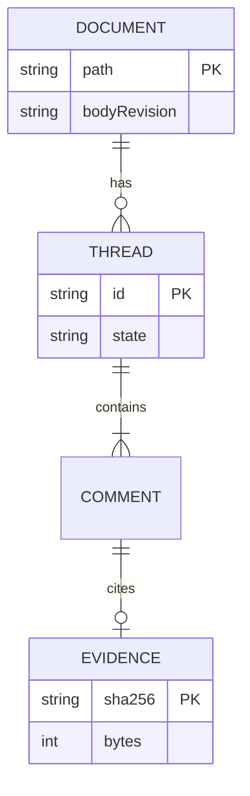

## Release plan

A Gantt chart.

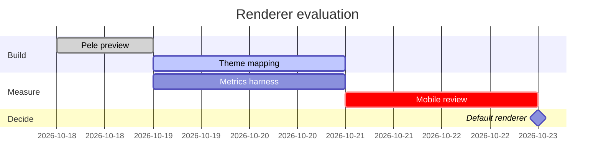

## Feature map

A mindmap.

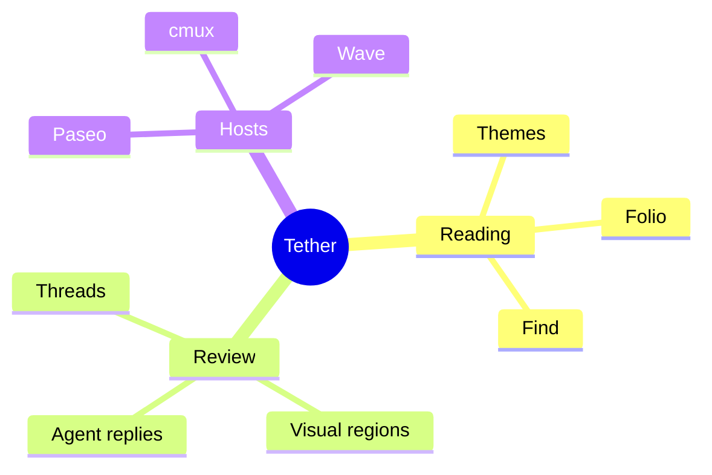

## Where review time goes

A pie chart.

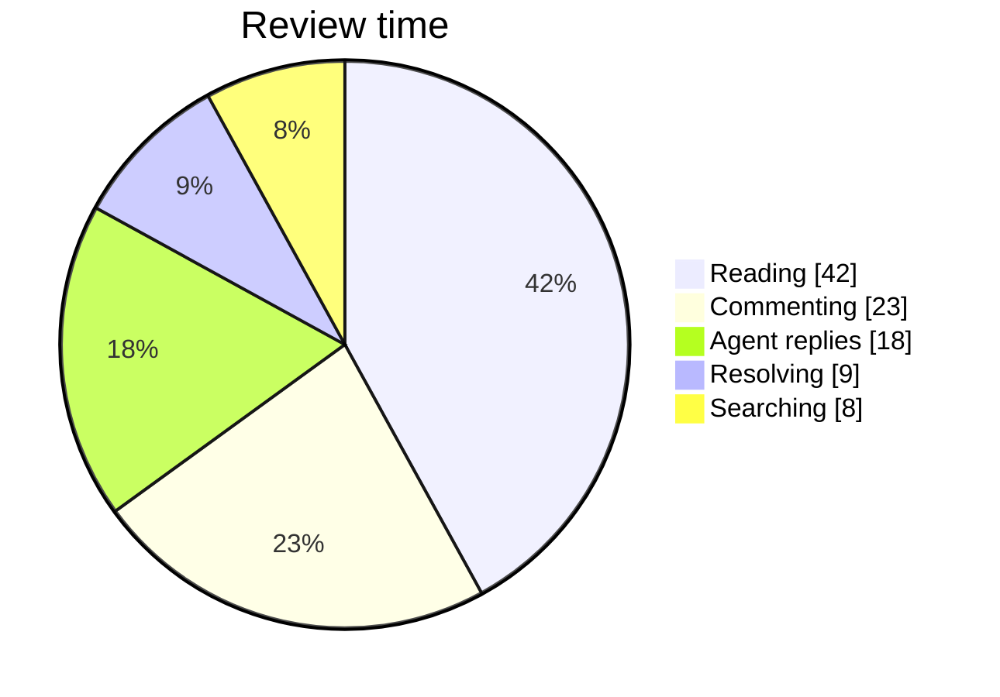

## Branch flow

A git graph.

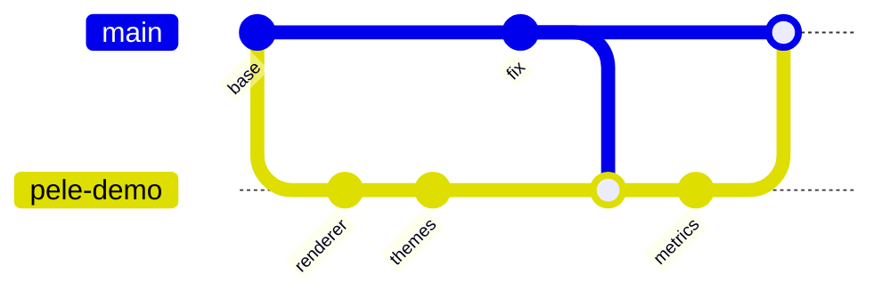

## Release history

A timeline.

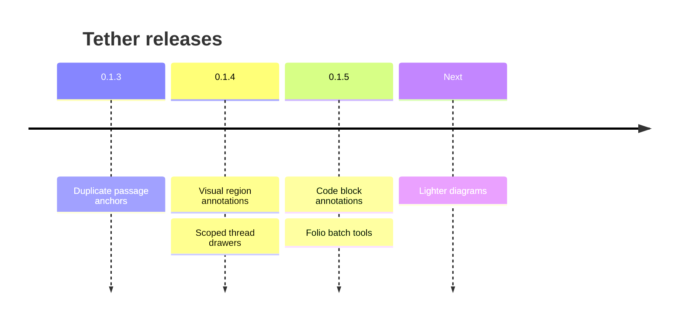

## Reviewer journey

A user journey.

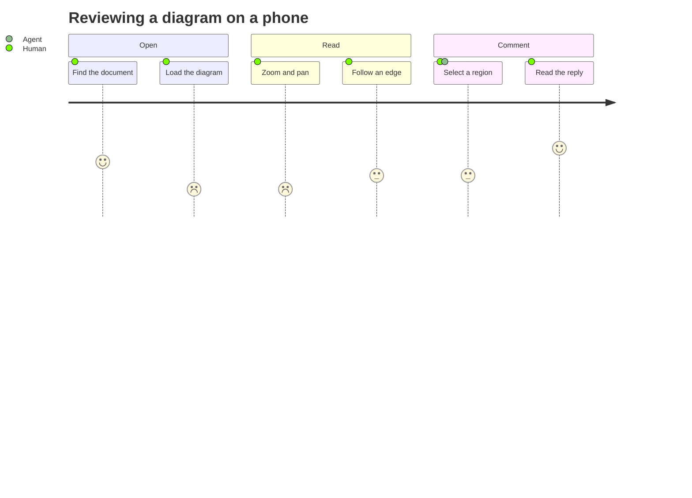

## Effort against value

A quadrant chart.

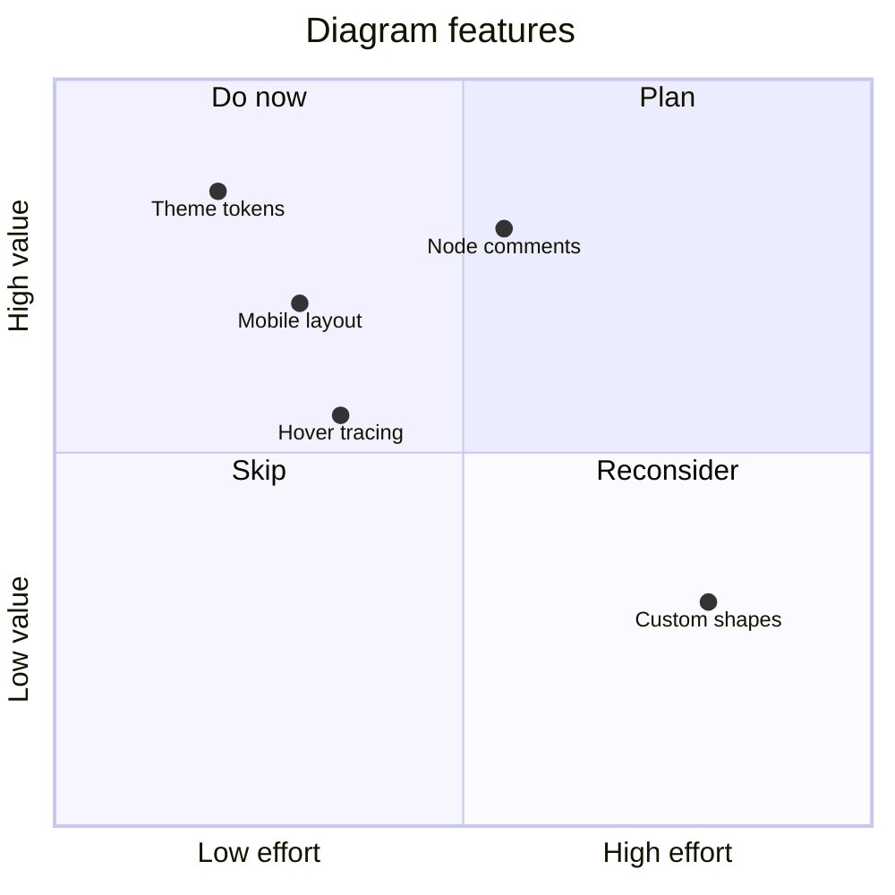

## Render time

An XY chart.

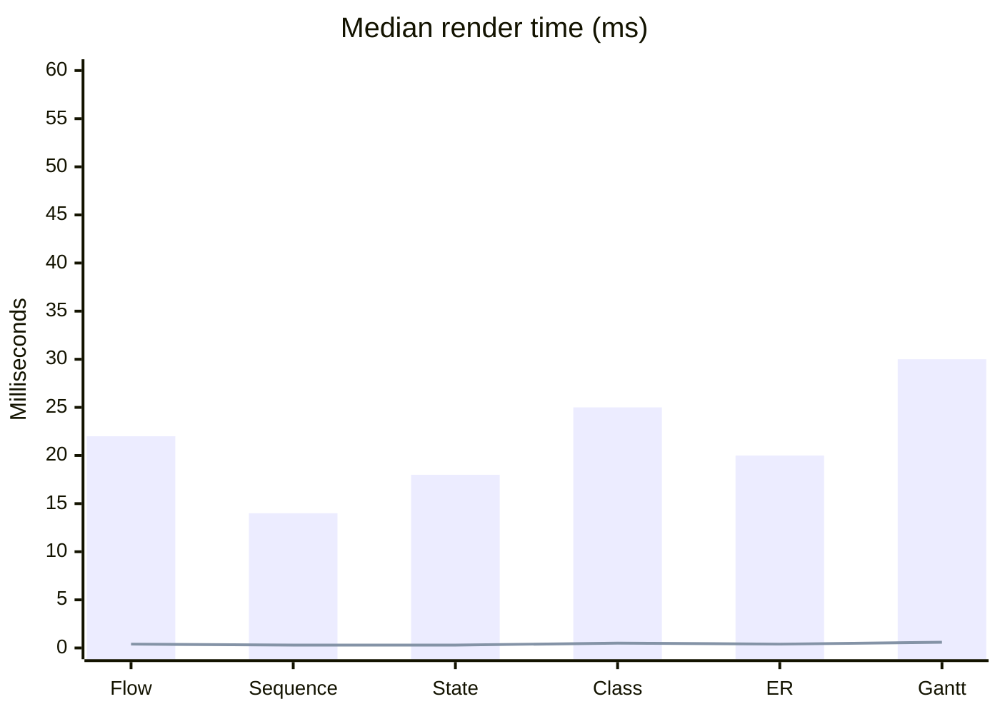

## Attention budget

A Sankey diagram.

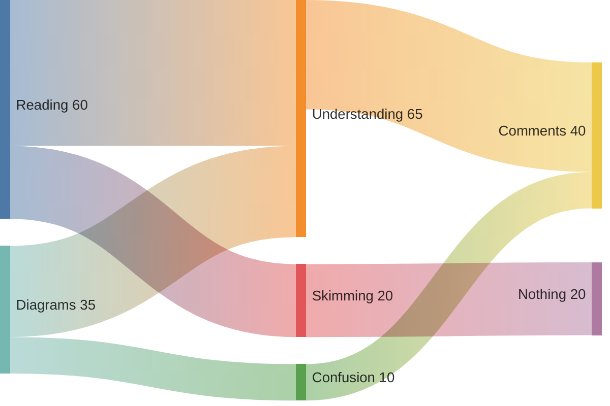

## Service layout

An architecture diagram.

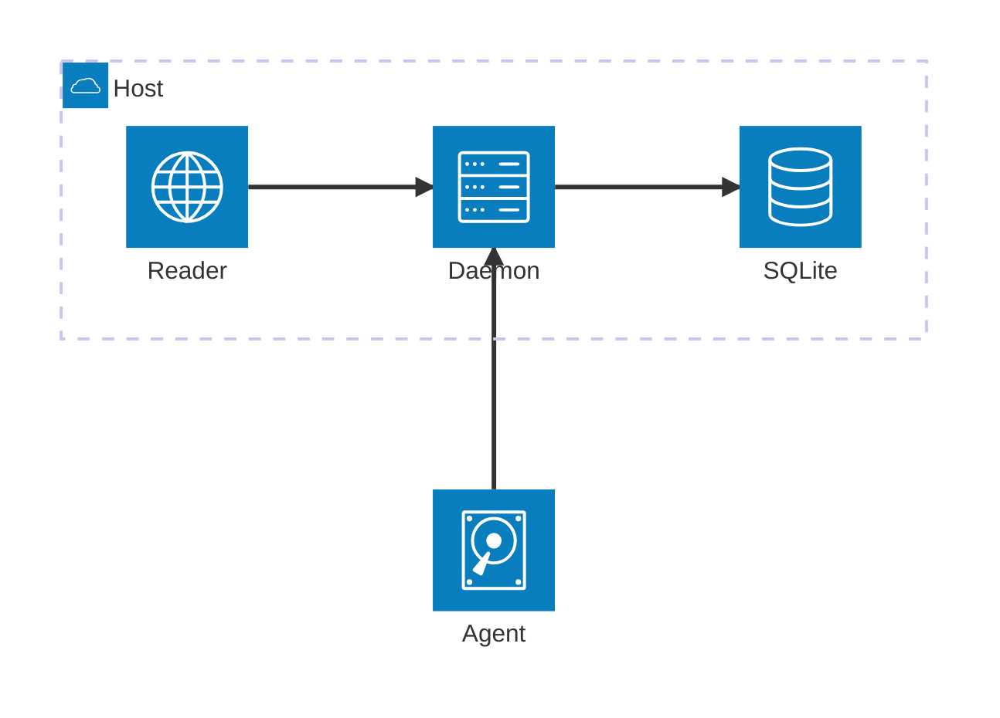
